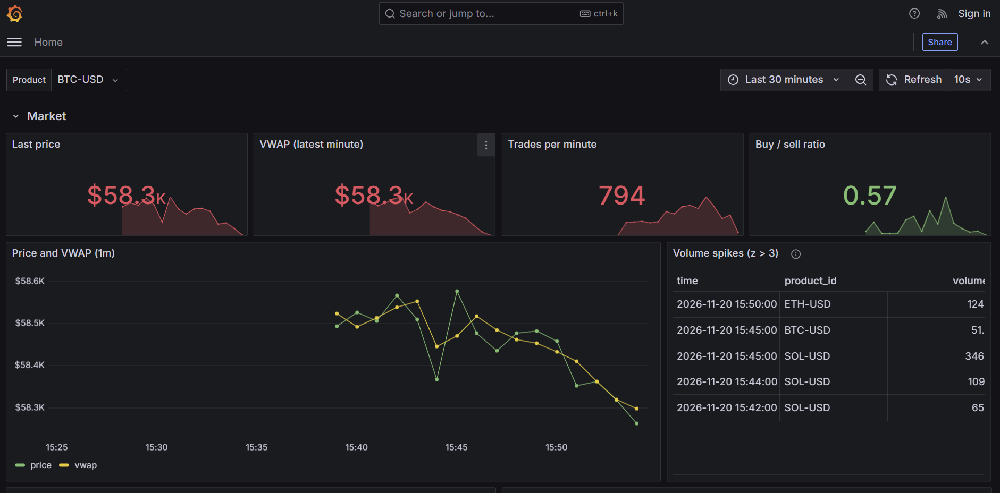
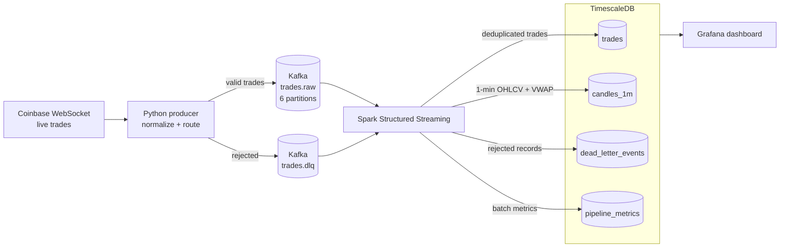

# Real-Time Market Data Pipeline


A streaming data pipeline that ingests live cryptocurrency trades from the Coinbase Exchange WebSocket feed, processes them with Spark Structured Streaming, and serves real-time market metrics and pipeline health on a Grafana dashboard.

The whole stack runs locally with one command.



---

## Architecture



| Layer | Technology | Role |
|---|---|---|
| Ingestion | Python, `websockets`, `confluent-kafka` | Subscribes to the Coinbase `matches` channel, normalizes each trade, publishes to Kafka with an idempotent producer |
| Messaging | Apache Kafka 3.8 (KRaft) | Durable buffer between ingestion and processing, keyed by product for per-symbol ordering |
| Processing | Spark Structured Streaming 3.5 | Validation, deduplication, event-time windowed aggregation with watermarks |
| Storage | TimescaleDB (PostgreSQL 16) | Time-partitioned hypertables, retention policy, analytical views |
| Serving | Grafana 11 | Auto-provisioned dashboard for market metrics and pipeline health |

---

## What it computes

Per product, per 1-minute event-time window:

- **OHLC** (open, high, low, close)
- **Volume** and **VWAP** (volume-weighted average price)
- **Buy vs sell volume** (order flow)
- **Trade count**
- **Price volatility** (standard deviation within the window)
- **Volume spikes**: windows where volume is more than 3 standard deviations above the trailing 30-minute average (SQL view)

---

## Engineering highlights

**Event-time processing with watermarks.** Candles are built on when a trade happened, not when it arrived. A 2-minute watermark lets late trades update their correct window, while bounding how much state Spark keeps. Trades later than the watermark are dropped and counted in `pipeline_metrics`.

**Dead-letter handling at two layers.** The producer rejects messages it cannot parse or that fail schema checks. Spark applies a second set of rules (null keys, non-positive price or size, bad timestamps). Both land in `dead_letter_events` with the reason and the original payload, so no record disappears silently.

**Idempotent, replay-safe writes.** Every sink is an upsert or insert-ignore on a natural key (`product_id + trade_id`, `product_id + bucket`, Kafka `topic + partition + offset`). If Spark retries a micro-batch after a failure, the database ends up in the same state. Combined with checkpointing, this gives effectively exactly-once results.

**Deduplication.** Raw trades are deduplicated in-stream with `dropDuplicatesWithinWatermark`, and again by primary key in the database.

**Built-in observability.** Each micro-batch records input rows, throughput, batch duration and late rows dropped. A freshness view shows how many seconds the newest trade lags behind real time. All of it is on the same dashboard as the market data.

**Scales out.** Kafka topics are partitioned by product, Spark writes per partition, and the Timescale hypertables are chunked by time with a 7-day retention policy on raw trades.

---

## Quick start

**Requirements:** Docker Desktop (4 GB+ memory allocated) and `make`.

```bash
git clone https://github.com/goregargi/realtime-market-data-pipeline.git
cd realtime-market-data-pipeline
cp .env.example .env

make up          # live Coinbase data
# or
make simulate    # offline: generated trades with injected bad and late events
```

On Windows without `make`, run `docker compose up -d --build` instead.

The first start takes a few minutes while images build and Spark downloads the Kafka connector. Then open:

| Service | URL |
|---|---|
| Grafana dashboard | http://localhost:3000 |
| Spark UI | http://localhost:4040 |
| TimescaleDB | `localhost:5432` (`make psql`) |

Candles appear on the dashboard about a minute after startup. Stop with `make down`, or `make clean` to remove all data.

---

## Data model

| Table / view | Grain | Notes |
|---|---|---|
| `trades` | one row per trade | Hypertable, 1-hour chunks, 7-day retention |
| `candles_1m` | product x minute | Hypertable, upserted as windows update |
| `dead_letter_events` | one row per rejected record | Reason, layer (producer or spark), raw payload, Kafka position |
| `pipeline_metrics` | query x micro-batch | Throughput, batch duration, late rows dropped |
| `volume_spikes` (view) | product x minute | Z-score of volume vs trailing 30 minutes |
| `data_freshness` (view) | product | Seconds since the latest trade |

Example queries:

```sql
-- Latest VWAP per product
SELECT DISTINCT ON (product_id) product_id, bucket, vwap
FROM candles_1m ORDER BY product_id, bucket DESC;

-- 5-minute candles rolled up from 1-minute data
SELECT product_id, time_bucket('5 minutes', bucket) AS bucket_5m,
       first(open, bucket) AS open, max(high) AS high, min(low) AS low,
       last(close, bucket) AS close, sum(volume) AS volume
FROM candles_1m
GROUP BY product_id, bucket_5m ORDER BY bucket_5m DESC LIMIT 20;

-- Why records were rejected
SELECT layer, reason, count(*) FROM dead_letter_events GROUP BY 1, 2 ORDER BY 3 DESC;
```

---

## Project structure

```
.
├── producer/
│   ├── producer.py            # WebSocket ingestion, validation, Kafka publishing
│   └── Dockerfile
├── streaming/
│   ├── stream_processor.py    # Spark job: queries, checkpoints, metrics loop
│   ├── transformations.py     # Parsing, validation and aggregation logic
│   ├── sinks.py               # Idempotent TimescaleDB writers
│   ├── run_sample.py          # Runs the logic on hand-made trades, no Kafka needed
│   └── Dockerfile
├── sql/init.sql               # Hypertables, retention, views
├── grafana/                   # Provisioned datasource and dashboard
├── docker-compose.yml
├── Makefile
└── .github/workflows/ci.yml   # Lint, compose validation, image builds
```

---

## Configuration

All settings are environment variables (see `.env.example`).

| Variable | Default | Description |
|---|---|---|
| `SOURCE` | `coinbase` | `coinbase` for live data, `simulate` for offline |
| `PRODUCTS` | `BTC-USD,ETH-USD,SOL-USD` | Coinbase product IDs to subscribe to |
| `TRIGGER_INTERVAL` | `10 seconds` | Spark micro-batch interval |
| `WATERMARK_DELAY` | `2 minutes` | How long to accept late trades |

---

## Design decisions

- **Kafka between ingestion and processing** so Spark can restart, be redeployed or fall behind without losing data, and so more consumers can be added later.
- **TimescaleDB instead of a plain warehouse** because the main access pattern is recent time ranges per symbol, and hypertables plus `time_bucket` handle that well.
- **foreachBatch sinks instead of the JDBC sink** to get upsert semantics, which the built-in JDBC writer does not support.
- **Candles are computed on the validated stream, dedup happens on raw trades.** Chaining two stateful operators in update mode is not supported cleanly in Spark 3.5. Coinbase trade IDs are unique and the producer is idempotent, so duplicate trades are rare, and the `trades` table is fully deduplicated.

---

## Roadmap

- Write the raw stream to a Delta Lake bronze layer on S3 for replay and backfills
- Schema Registry with Avro for producer and consumer contracts
- Alerting on freshness and dead-letter rate through Grafana alerts
- Deploy to Kubernetes with Helm (Strimzi for Kafka, Spark Operator)

---

## Data source

Market data comes from the public Coinbase Exchange WebSocket feed (`wss://ws-feed.exchange.coinbase.com`, `matches` channel). No API key is required.